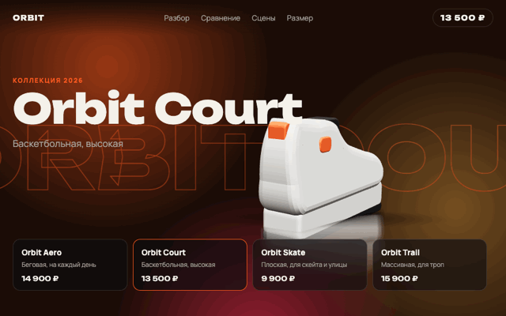

# ORBIT — 3D-витрина кроссовок

**Демо:** https://isaturnalia.github.io/sneaker-explode/



Фанатская 3D-витрина для портфолио: пять культовых кроссовок, которые по скроллу разбираются на детали. Это не магазин: здесь ничего не продаётся, названия моделей и логотипы принадлежат их правообладателям.

## Модели

| Модель | Год | Как разбирается |
|---|---|---|
| Nike Air Jordan 1 | 1985 | 34 детали: панели верха, воротник, шнурки, стелька, подошва |
| New Balance 997 | 1991 | 34 детали: накладки, сетка, подкладка, шнурки, подошва |
| Salomon X Ultra 04 | 2021 | 3D-скан из одного куска, разрезан по высоте на 4 слоя |
| Nike Air Zoom Pegasus 36 | 2019 | 28 деталей |
| Shopify Sample Runner | 2021 | 25 деталей, учебная модель Khronos |

## Блоки

| # | Блок | Что происходит |
|---|---|---|
| 1 | **Выбор модели** | Пять карточек. Старая кроссовка разлетается на детали, новая собирается |
| 2 | **Разбор** | По скроллу кроссовка разбирается в четыре шага: шнуровка, верх, подкладка, подошва |
| 3 | **Паспорт** | Бренд, год, тип, число деталей в 3D и автор модели |
| 4 | **Материал** | Камера по скроллу наезжает на верх кроссовки |
| 5 | **Сцены** | Город ночью, спортзал, тропа: меняются фон, свет и постамент |

Модель и сцена сохраняются в адресе страницы (`?m=nb997&sc=gym`).

## Как модель делится на детали

`js/models/gltf.js` работает с любым GLB со Sketchfab:

1. Все меши переводятся в общие координаты. Лишнее (коробка, вторая кроссовка из пары) выбрасывается заранее, при подготовке файла.
2. Каждый меш делится на несвязанные «острова»: вершины склеиваются по позиции, чтобы швы развёртки не рвали деталь.
3. Мелкие острова (строчки, логотипы) приклеиваются к ближайшей крупной детали.
4. По положению и размеру деталь получает слой: шнуровка, верх, подкладка или подошва. Подошвы раскладываются стопкой.
5. Если модель — цельный скан (Salomon), она режется по высоте на слои, а главная ось следа выравнивается автоматически.

## Эффекты

- **Палитра модели.** У каждой модели свой фон, акцент и три пятна света (`THEMES` в `js/data.js`). Цвета плавно перетекают: CSS-переменные зарегистрированы через `@property`.
- **Пятна света** за прозрачной 3D-сценой медленно дрейфуют и сдвигаются по скроллу.
- **Слежение.** Кроссовка поворачивается за курсором, на телефоне — за наклоном (на iPhone включается кнопкой).
- **Пол с отражением.** `Reflector` из three.js со своим шейдером: размытое отражение, которое угасает к краям.
- **Бегущее название** модели контуром за кроссовкой, скролл разгоняет ленту.
- **Искры** цвета акцента, когда детали разъезжаются или собираются.
- При `prefers-reduced-motion` дрейф, слежение, искры и анимации переходов отключены.

## Вес

Модели подготовлены скриптом: лишние объекты удалены, геометрия переупакована, текстуры уменьшены до 1024 px и пережаты в JPEG, материал Salomon переведён из устаревшего spec/gloss в metal/rough.

| Модель | Было | Стало |
|---|---|---|
| Air Jordan 1 | 69 МБ | 6,3 МБ |
| New Balance 997 | 34 МБ | 4,5 МБ |
| Salomon X Ultra 04 | 48 МБ | 1,5 МБ |
| Pegasus 36 | 15 МБ | 3,6 МБ |
| Sample Runner | 7,6 МБ | 1,8 МБ |

Первой грузится открытая модель, остальные догружаются в фоне по очереди.

## Стек

HTML, CSS и JavaScript без сборки.

- [three.js](https://threejs.org/) 0.160 через importmap (jsDelivr)
- [GSAP](https://gsap.com/) 3.12.5 и ScrollTrigger (cdnjs)
- Шрифты Unbounded и Manrope (Google Fonts)

## Запуск

ES-модулям нужен локальный сервер.

```bash
python3 -m http.server 5391
```

Затем открыть http://localhost:5391.

При каждом релизе метку `?v=N` нужно поднять во всех файлах сразу: сайт сверяет её с сервером и перезагружается, если открыта устаревшая копия.

## Структура

```
index.html             разметка блоков
css/style.css          стили и адаптив
js/main.js             сцена, положение модели по блокам, интерфейс
js/data.js             каталог, паспорта, авторы, сцены, палитры
js/models/common.js    нормализация размера и разборка по шагам
js/models/gltf.js      загрузка моделей со Sketchfab и деление на детали
js/models/real.js      учебная модель Shopify с вариантами материалов
assets/models/         подготовленные модели
assets/aero.glb        учебная модель Shopify
og.png                 картинка для превью ссылки
docs/demo.gif          запись для README
```

## Авторы 3D-моделей

Все модели под лицензией [CC BY 4.0](https://creativecommons.org/licenses/by/4.0/). Изменения: удалены лишние объекты, уменьшены текстуры, геометрия разделена на детали в коде.

- [Nike Air Jordan 1](https://sketchfab.com/3d-models/nike-air-jordan-1-fbe52211197c4b449f29de5aa4eb0611) — DeezVertz (на основе работ makoto и samplemem)
- [New Balance 997](https://sketchfab.com/3d-models/new-balance-997-05e79a2dffbc4356bba7e0751fada08f) — Isaiah
- [Salomon X Ultra 04W](https://sketchfab.com/3d-models/salomon-x-ultra-04w-2734560ce87a4f93bd64c61329257070) — inciprocal
- [Nike Air Zoom Pegasus 36](https://sketchfab.com/3d-models/nike-air-zoom-pegasus-36-00fd99e778c244c3bd3b65f99dad7cb2) — quaz30
- [Materials Variants Shoe](https://github.com/KhronosGroup/glTF-Sample-Assets/tree/main/Models/MaterialsVariantsShoe) — © 2021 Shopify

Названия моделей, логотипы и дизайн кроссовок принадлежат Nike, New Balance и Salomon. Витрина не связана с этими компаниями.
